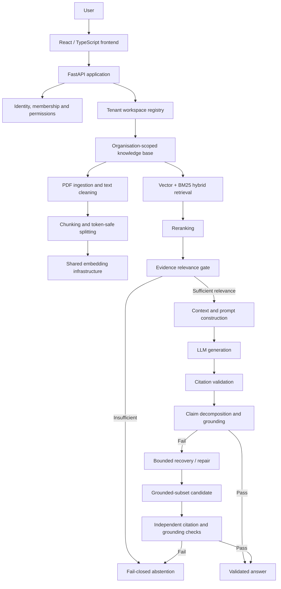

# EKIP — Verified System Architecture

**Prepared:** 9 November 2026\
**Repository baseline observed:** `feature/organisation-knowledge-management` at `9918263`

## 1. Architecture overview

EKIP combines an organisation-aware enterprise application with an evidence-constrained RAG engine.

This is a conceptual flow from inspected modules, not every middleware, transaction or deployment component.

## 2. Frontend and API

### Frontend

React, TypeScript and Vite. Inspected source includes application shell/routing, authentication context, login page, document library, knowledge-base context, workspace/query UI, platform administration, tenant administration, API client/types and tests.

Routes observed in candidate checks: `/`, `/library`, `/workspace`, `/platform`, `/tenant/settings`, `/403`, `/forbidden`.

### FastAPI backend

`src/api/main.py` contains route groups observed for:

| Domain | Routes/capabilities |
|---|---|
| Authentication | `/auth/login`, `/auth/refresh`, `/auth/logout`, `/auth/me` |
| Audit | `/audit/events`, platform audit |
| Tenant | `/tenant/overview`, `/tenant/members`, member update/delete, invitations, settings |
| Invitation acceptance | `/auth/invitations/accept` |
| Platform | `/platform/overview`, organisation list/create, suspend/reactivate, platform roles, user administration, provisioning approval/retry/recovery |
| Runtime | `/health`, `/tenant/status` |
| Knowledge | `/documents` GET/POST, download/delete, `/query` POST |

The inspected limits are 25 MiB per upload, 4,000 question characters and 255 filename characters. Confirm current signatures and authorization dependencies in source before changing contracts.

## 3. Identity, tenancy and authorization

Inspected model classes include `Organisation`, `User`, `OrganisationMembership`, `TenantOnboarding`, `PlatformRoleAssignment`, `RefreshSessionRecord`, `AuditEvent`, `OrganisationSettings` and `OrganisationInvitation`.

Organisation/user identifiers are UUIDs. Organisation slugs and user emails are normalized. Membership is unique per organisation/user pair and carries an organisation-scoped role. The user model retains a legacy `is_platform_admin` boolean for compatibility.

Organisation roles:
- `organisation_administrator`
- `contributor`
- `reader`

Platform roles:
- `platform_super_administrator`
- `platform_tenant_creator`
- `platform_tenant_approver`
- `platform_provisioning_operator`

The permission layer separates platform roles from organisation memberships. The legacy `is_platform_admin` field maps to super-administrator permissions during the compatibility period.

Tenant onboarding states observed in the model:
- `registration_pending`
- `provisioning`
- `provisioning_failed`
- `pending_admin`
- `active`
- `suspended`
- `rejected`

The model includes idempotency information, creator/approver references, attempt counts, timestamps, error code and invitation linkage. Consult migrations and service code for exact transition rules.

## 4. Tenant data architecture

`src/api/tenant_storage.py` implements:
- `TenantWorkspace` per organisation.
- Organisation-specific root and upload directory.
- JSON manifest.
- Tenant-scoped `KnowledgeBase`.
- Lazy pipeline construction.
- Per-workspace read/write and pipeline locks.
- Registry validating canonical UUIDs and guarding symlink/path escape.
- Restoration from UUID-named directories and manifests.

The module describes a separate manifest, upload directory, chunk collection and retriever per organisation. Shared embedding and reranking dependencies can be reused. Legacy global documents are not automatically imported into tenant workspaces.

Manifest writes use a temporary file, flush/fsync and `os.replace`. Restoration ignores unrelated/legacy files and records failed document restoration. `KnowledgeBase` adds PDF pages, chunks and embeds them, updates its retriever, and builds a replacement index before mutating current records during document deletion.

## 5. Ingestion, embeddings and retrieval

Inspected modules:
- `src/ingestion/pdf_loader.py`, `text_cleaner.py`
- `src/chunking/text_chunker.py`, `token_safe_splitter.py`
- `src/embeddings/embedder.py`
- `src/retrieval/vector_store.py`, `bm25_retriever.py`, `hybrid_retriever.py`, `rrf.py`, `reranker.py`, `reranked_retriever.py`, `retriever.py`

`KnowledgeBase` defaults to chunk size 200 and overlap 30. These are implementation defaults, not immutable product requirements.

`src/rag_pipeline.py` supports `custom` and optional `llamaindex` retrieval backends through `EKIP_RETRIEVAL_BACKEND` (default `custom`). The inspected LlamaIndex path retains EKIP chunking, embeddings and hybrid retrieval while substituting LlamaIndex `SentenceTransformerRerank` for the custom reranker.

## 6. Evidence-constrained generation

Active `rag_pipeline.py` flow:

1. Retrieve tenant-scoped documents.
2. Apply `check_evidence()` from `evidence_gate.py`.
3. Abstain if evidence is insufficient.
4. Build context and prompt.
5. Generate through the configured LLM client.
6. Validate `[Source N]` markers against the source map.
7. Evaluate claims with `GroundingEvaluator`.
8. Attempt answerability recovery if the initial answer abstains despite passing relevance.
9. Attempt grounding repair when citations/grounding fail.
10. If repair fails, optionally assemble a subset of already-grounded atomic claims.
11. Re-run citation and grounding checks on the subset.
12. Return validated answer or abstention.

### Evidence gate

`src/generation/evidence_gate.py` currently sets `DEFAULT_THRESHOLD = 4.3`. Code comments say this is calibrated against the NIST CSF 2.0 benchmark and is a starting threshold, not universal. It uses the best finite score among retrieved documents with usable text. Missing usable evidence or valid scores fails closed.

### Citation validation

`citation_validator.py` extracts `[Source N]` markers and verifies the source number exists in `source_map`. Citation existence is distinct from semantic support.

### Claim-level grounding

`grounding_evaluator.py` parses claims, explicitly marks uncited claims, decomposes cited claims into atomic claims, selects evidence from cited sources and evaluates semantic relationships. It uses entailment/contradiction confidence thresholds, content-overlap safeguards and an exact enumerated-list membership rule. A strong contradiction from one cited source is not hidden by support from another.

Statuses: `grounded`, `unsupported`, `contradicted`, `uncited`. Overall acceptance requires all evaluated claims to be grounded.

### Repair and fail-closed behavior

`answer_repair.py` contains abstention recognition, `answer_passes_grounding()`, bounded diagnostic summaries, `build_grounded_subset_answer()` and repair/recovery prompt builders.

Grounded-subset construction copies evaluator-approved atomic claim text, attaches an existing source number and does not rewrite the claim. The caller independently validates citations and grounding again. Failure returns the explicit abstention text.

### Separate utility

`grounding_validator.py` defines `validate_grounding()`. The inspected source-reference search found no production caller; it is referenced by its own unit test. Treat it as a separate utility, not an active pipeline stage unless later inspection shows otherwise.

## 7. Diagnostics and privacy

Content-bearing retrieval diagnostics are disabled by default. `EKIP_DEBUG_RETRIEVAL_LOGGING` enables additional retrieval diagnostics. `EKIP_DEBUG_GENERATION_DETAILS` enables answer/grounding/citation details in repair diagnostics. Source comments warn that snippets can contain tenant-confidential content.

Normal logs are designed not to contain questions, answers, prompts or retrieved text. Default error handling logs exception class; debug mode can log full exceptions.

The inspected API uses in-process login/refresh throttles; comments state counters reset on restart and are not shared across multiple workers. The comments describe a single-Uvicorn-worker assumption; revisit before horizontal scaling.

## 8. Persistence and migrations

The migration chain present:
- `0001_identity_foundation`
- `0002_auth_refresh_sessions`
- `0003_auth_hardening`
- `0004_scoped_security_audit`
- `0005_tenant_onboarding`
- `0006_platform_roles_and_recovery`
- `0007_tenant_admin` (file named `0007_tenant_invitations_and_settings.py`)
- `0008_invitation_lifecycle`

The candidate database was reported at `0008_invitation_lifecycle`. At the inspected Git snapshot, migrations 0005–0008 were untracked; preserve them.

## 9. Candidate deployment boundary

`Dockerfile.unified` uses `ekip-api:task05.3-isolation` as a base, performs import checks, copies backend source/migrations/Alembic configuration and built frontend, runs as UID/GID 10001, uses `/app/data/tenants`, supports offline model cache `/models`, and runs Uvicorn on port 8000.

`UNIFIED_DEPLOYMENT.md` describes candidate-only deployment. Candidate DB/container/volume and PostgreSQL test resources are protected. Candidate health checks do not establish production readiness.

## 10. Not established by this inspection

Do not assume completion of production high availability, backup/restore, external SSO, formal retention/deletion guarantees, per-tenant encryption/key management, production observability/incident response, production LLM routing, multi-tenant capacity testing, independent penetration testing or release approval.
